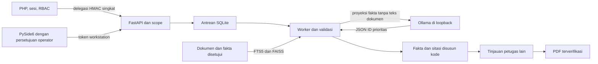

# Arsitektur dan aliran data

Antrean mengikat ID, status, lease, percobaan dan pembatalan pada database khusus. Model tidak mempunyai koneksi ke database web atau antarmuka aksi. Dokumen dan data sumber dipisahkan dari system instruction. Model menerima ID fakta, kategori, nilai numerik, dan opsi tindakan tetap. Aplikasi menyusun sitasi dan rekomendasi setelah memeriksa semua ID. PDF memakai generator PHP yang sama setelah hasil diverifikasi petugas lain.
